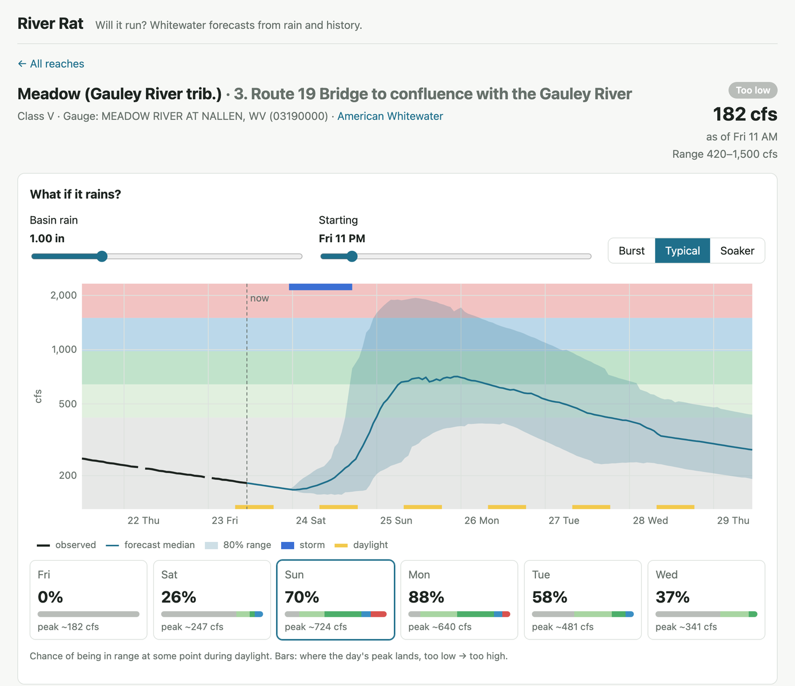
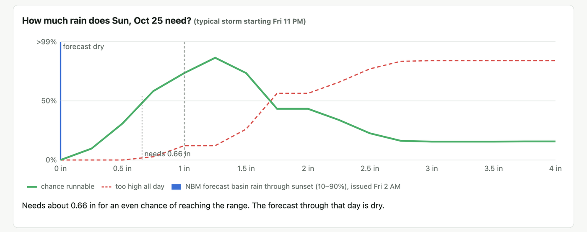

# River Rat

**Will my river be runnable on the day I want to go?** River Rat forecasts whether whitewater rivers in the Southern Appalachians, Virginia, West Virginia, and Maryland will be in their runnable range up to 6 days out. It works from live gauges, NOAA rain data, and a model of how each river has responded to rain over the last 24 years. Forecasts come as probabilities, and they're tested against what the rivers actually did.



*Above: the Lower Meadow is too low today. If its watershed got 1 inch of rain tonight, the chance of a runnable day would peak at 88% on Monday. Shown: the last 48 hours of flow, the forecast median and 80% range drawn over the reach's flow bands, and each day's chance of being in range during daylight.*

## What it does

- **What-if slider.** Pick a rain amount, a storm type (3-hour thunderstorm, typical 18-hour storm, or 36-hour soaker), and when it starts. See the river's predicted hydrograph, the chance of running each day, and the past storms behind the forecast.
- **Rain needed.** For each day, the least rain that gives an even chance of reaching the runnable range, drawn against NOAA's forecast basin rain.
- **Honest uncertainty.** Every forecast is a weighted set of possible futures, so it shows a range and a probability rather than one line.
- **1,497 reaches** from the American Whitewater catalog. Those with a usable USGS gauge are forecast through 309 gauges with long enough records. Low, medium, and high bands come from each reach's runnable range. "Runnable" means in range at some point between sunrise and sunset.



## How it works

```
USGS 15-min flow (2002→now)  ┐
NOAA radar rain per basin    ├─▶ hourly table per gauge ─▶ past storms + responses ─▶ analog model ─▶ daily runnability
NOAA rain forecast (NBM)     ┘    (flow + watershed rain)     (367,000 storm events)     (60 nearest     (sunrise→sunset,
                                                                                          storms)         per reach's bands)
```

1. **Rain where it matters.** Each gauge's watershed is delineated (USGS NLDI), and hourly rain from NOAA's radar/gauge analyses is averaged over it. Rain on the watershed drives the river, not rain at the nearest town.
2. **Storm library.** 24 years of hourly flow and basin rain are split into storms. For each one, the library records the flow when it started, how wet the ground already was, the rain's total, duration, and intensity, the season, and the river's response.
3. **Analog forecast.** For a new storm, the model finds the 60 most similar past storms at that gauge and replays their hydrographs from today's flow, scaled to this storm's rain. Their spread is the uncertainty. Between storms, flow follows the gauge's own fitted recession curve.
4. **From flow to "will it run".** Each possible future is checked against the reach's bands during that day's daylight. Reaches rated in feet use a stage–flow rating fitted from each gauge's own readings (median error 0.015 ft).

## Results

Tested on 49,582 storms from 2020–2022 at 309 gauges. The model's library held only storms through 2019, and observed rain stood in for the rain forecast, which isolates how well it predicts the river's response. 2023 onward is held out as a final test set.

| Model | Forecast error (CRPS, log flow) | Peaks inside the 80% range |
|---|---|---|
| Persistence (flow stays where it is) | 0.476 | 1% |
| Average response of all past storms | 0.304 | 78% |
| **River Rat analog model** | **0.182** (40% lower) | **80%** |

The analog model beats the average-response baseline at **every one of the 309 gauges**, with a typical gain of 42%. Its probabilities are calibrated: across ~340,000 reach-days, forecasts of 30%, 50%, 70%, and 97% came true 30%, 51%, 73%, and 97% of the time.

## Built with

Python (NumPy, PyArrow, SQLAlchemy, FastAPI) · PostgreSQL + PostGIS · React + TypeScript (Vite) with hand-drawn SVG charts · Docker Compose · GitHub Actions. Data: USGS Water Data API, NOAA Stage IV and AORC rain, NOAA National Blend of Models forecasts (GRIB2, read by byte range from AWS), USGS NLDI watersheds, and American Whitewater's reach catalog.

**Status:** the data pipelines, model, What-if API, and reach page are done. Next up is the Outlook, a home page that ranks every reach by its chance of running over the next 6 days using NOAA's rain forecast. [DESIGN.md](DESIGN.md) has the full design, the decision log, and the roadmap.

## Layout

| Path | What |
|---|---|
| `backend/` | Python: data ingestion, forecasting models, FastAPI (`riverrat` package) |
| `web/` | React + TypeScript (Vite) |
| `DESIGN.md` | Design document |

## Running it locally

Requirements: Docker (Docker Desktop or [Colima](https://github.com/abiosoft/colima)), [uv](https://docs.astral.sh/uv/), [pnpm](https://pnpm.io/), Node 22+.

### Everything in containers

```sh
cp .env.example .env    # optional, the defaults work
docker compose up --build
```

- Web: http://localhost:5173
- API: http://localhost:8000/api/health (interactive docs at `/docs`); What-if for a reach: `/api/reaches/{id}/whatif?rain_in=1.5&start_h=12` and `/api/reaches/{id}/rain-response`
- Postgres + PostGIS: `localhost:5432` (user, password, and database are all `riverrat`)

The API container applies database migrations on startup.

### Backend on the host

If the repo lives in an iCloud-synced folder (e.g. Desktop), iCloud marks `.venv` files hidden and Python 3.13 then ignores them. Keep the venv and the data folder in iCloud-excluded folders: `mkdir backend/.venv.nosync data.nosync && ln -s .venv.nosync backend/.venv && ln -s data.nosync data` before `uv sync`.

GRIB decoding uses ecCodes. On macOS `uv sync` installs it bundled with the Python package; on Linux install the system library first (`apt-get install libeccodes0`), as the Dockerfile and CI do.

```sh
docker compose up -d db
cd backend
uv sync
uv run alembic upgrade head
uv run uvicorn riverrat.api.main:app --reload
uv run pytest
uv run ruff check . && uv run ruff format --check .

# Sync the American Whitewater reach catalog (facts only, 1 request / 5 s)
uv run python -m riverrat.jobs.sync_reaches --index-only   # ~1,500 pilot reaches, 1 request
uv run python -m riverrat.jobs.sync_reaches                # + reach details, ~2 h first run

# USGS gauges (needs USGS_API_KEY in .env; 1,000 requests/hour)
uv run python -m riverrat.jobs.usgs sites      # locations + periods of record
uv run python -m riverrat.jobs.usgs live       # last 3 h of 15-min readings -> Postgres
uv run python -m riverrat.jobs.usgs backfill   # 15-min history since 2002 -> data/usgs/iv/

# NOAA forecasts (NWPS keeps no history, so archive every few hours)
uv run python -m riverrat.jobs.noaa link       # gauges -> NWS location IDs + NWM reaches
uv run python -m riverrat.jobs.noaa archive    # store new RFC + NWM short-range forecasts

# Watersheds (after usgs sites)
uv run python -m riverrat.jobs.basins          # NLDI basin polygon per USGS gauge

# Rain history (after basins): hourly basin means from AORC, ~4 min per year
uv run python -m riverrat.jobs.rain backfill   # 2002 onward -> data/rain/aorc/{year}.parquet
uv run python -m riverrat.jobs.rain recent     # Stage IV since AORC ends -> Postgres basin_rain
uv run python -m riverrat.jobs.rain_forecast archive  # NBM rain percentiles -> Postgres rain_forecast

# Training tables and storm events (after the flow and rain backfills; rebuilds from scratch)
uv run python -m riverrat.jobs.events hourly   # flow + basin rain per hour -> data/hourly/{site}.parquet
uv run python -m riverrat.jobs.events extract  # past storms and responses -> data/events/events.parquet

# Score the analog model on storms it never saw (library <= 2019; 2023+ is the held-out test)
uv run python -m riverrat.jobs.hindcast analog # 2020-22 storms -> data/skill/{analog,runnable}_2020-2022.parquet

# Stage ratings for reaches in feet (the worker refits daily)
uv run python -m riverrat.jobs.ratings         # -> data/ratings/ratings.json
```

Long backfills can run in a container so they survive closing the terminal:

```sh
docker compose run -d --name riverrat-rain worker python -m riverrat.jobs.rain backfill
docker logs -f riverrat-rain
```

### Scheduled jobs

The `worker` container (`docker compose up -d worker`) runs recurring jobs from `riverrat/jobs/scheduler.py`. Each job runs at startup and then on its interval; `docker compose logs -f worker` shows them. They only run while Docker is up, so on a laptop expect gaps while it sleeps.

| Job | Every | Steps |
|---|---|---|
| `usgs-live` | 15 min | `usgs live` (the last 3 hours of 15-minute readings; prunes readings older than 60 days) |
| `noaa-archive` | 3 h | `noaa link`, `noaa archive` |
| `rain-recent` | 1 h | `rain recent --max-hours 48` (new Stage IV hours, plus revisions from the last 2 days) |
| `rain-forecast` | 1 h | `rain_forecast archive` (NBM 00/06/12/18Z runs from the last 2 days not yet stored) |
| `ratings` | 1 day | `ratings` (stage ratings for reaches in feet -> data/ratings/ratings.json) |

After changing backend code, rebuild with `docker compose up -d --build worker`.

### Web on the host

```sh
cd web
pnpm install
pnpm dev      # proxies /api to localhost:8000
```

## Data and attribution

River Rat uses river information from [American Whitewater](https://www.americanwhitewater.org/), gauge data from the [USGS](https://waterdata.usgs.gov/), and forecasts from [NOAA](https://water.noaa.gov/). Scraped or downloaded data is never committed to this repository.

River Rat is not an official forecast. Never rely on it alone for safety decisions on the river.
