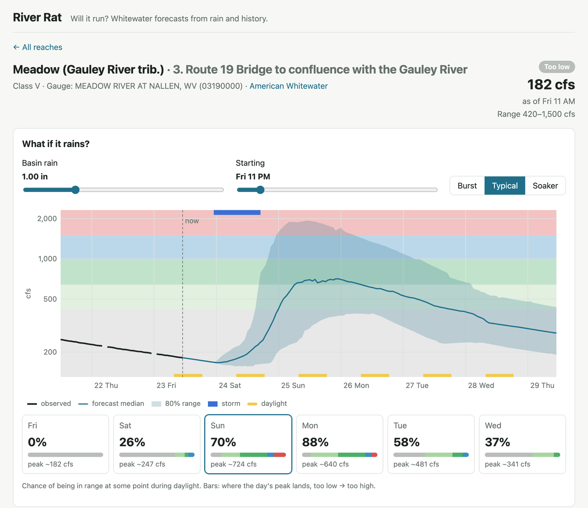

# River Rat

**Live: [river-rat.app](https://river-rat.app)**

**Will my river be runnable on the day I want to go?** River Rat forecasts whether whitewater rivers in the Southern Appalachians, Virginia, West Virginia, and Maryland will be in their runnable range up to 6 days out. It works from live USGS gauges, NOAA's rain forecast, and a model of how each river has responded to rain over the last 24 years.

## What it does

- **Outlook:** every forecast reach's chance of running on each of the next 6 days, with a rain slider that asks "what if every watershed got 1.5 inches tonight?"
- **What-if:** pick a storm's size, type, and start time for any reach, and see the predicted flow and the past storms behind it.
- **Coverage:** about 1,500 reaches from American Whitewater's catalog, about 975 of them forecast through 391 USGS gauges.

## How it works

1. **Rain on the watershed.** Hourly NOAA radar rain is averaged over each gauge's watershed, which comes from USGS NLDI.
2. **Storm library.** 24 years of hourly flow and rain are split into 367,000 storms, each with its starting flow, ground wetness, rain, season, and how the river responded.
3. **Analog forecast.** For a new storm, the 60 most similar past storms at that gauge are replayed from today's flow. Their spread is the forecast's uncertainty.
4. **Will it run?** Each possible future is checked against the reach's runnable range during daylight, giving a chance of running for each day.

## Results

Tested on 61,991 storms (2020–2022) at 391 gauges that the model never trained on:

| Model | Forecast error (CRPS) | Peaks inside the 80% range |
|---|---|---|
| Flow stays where it is | 0.481 | 1% |
| Average of all past storms | 0.306 | 78% |
| **River Rat** | **0.185** (40% lower) | **81%** |

Its chances are honest: forecasts of 30%, 50%, 70%, and 97% came true 30%, 51%, 73%, and 97% of the time.

## Built with

Python (FastAPI, NumPy, SQLAlchemy) · PostgreSQL + PostGIS · React + TypeScript · Docker on Google Cloud · GitHub Actions. AI Assisted development with Claude Code for CLI.

## More

- [docs/DEVELOPMENT.md](docs/DEVELOPMENT.md): running it locally, the data pipeline, and deploying
- [DESIGN.md](DESIGN.md): full design, decision log, and roadmap

## Data and attribution

River data from [American Whitewater](https://www.americanwhitewater.org/), gauges from the [USGS](https://waterdata.usgs.gov/), and rain from [NOAA](https://water.noaa.gov/). Downloaded data is never committed to this repository. River Rat is not an official forecast; never rely on it alone for safety on the river.
